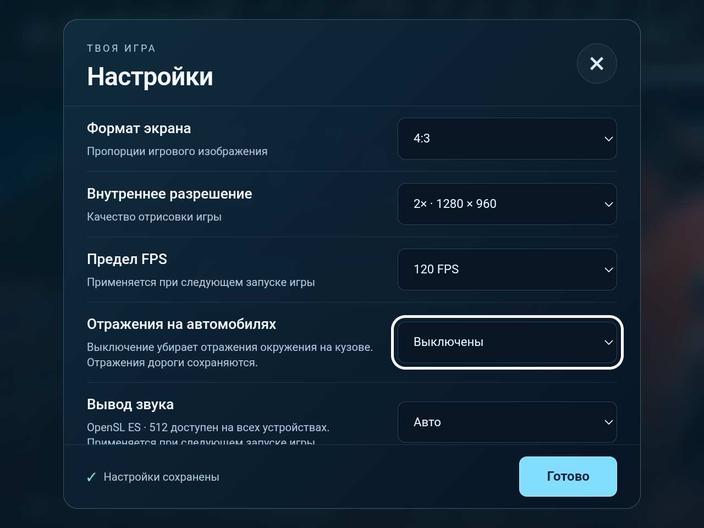
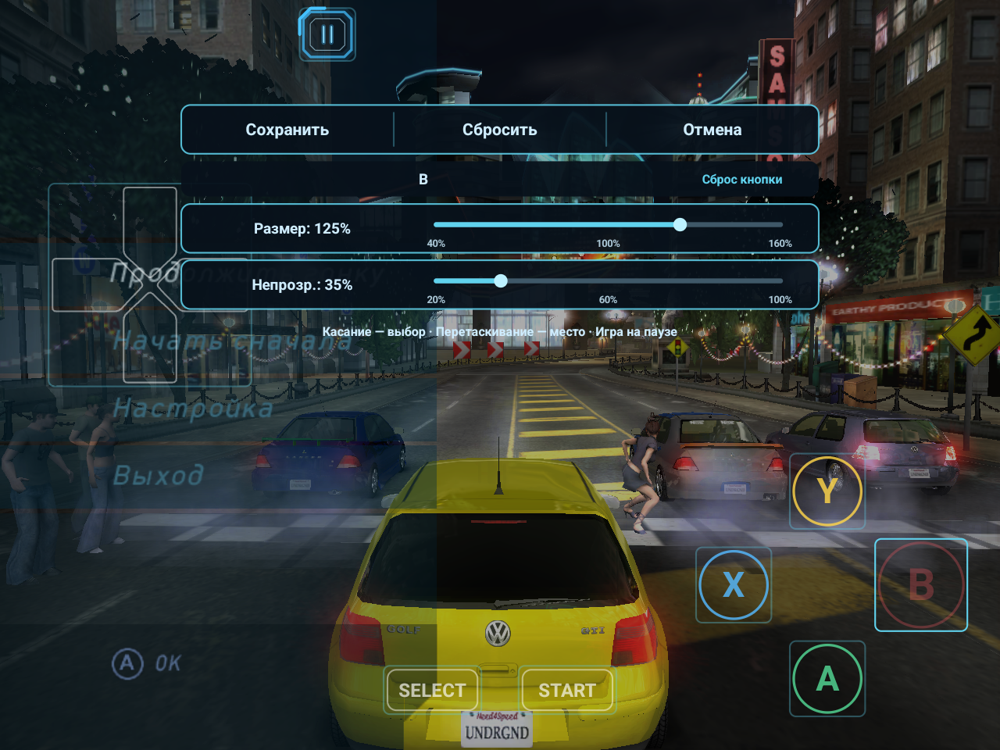

**English** · [Русский](GUIDE-RU.md) · [Project overview](../README.en.md) · [Release notes](RELEASE-NOTES-EN.md)

# Controls, settings and saved progress

Guide for **0.2.0-preview.9**, October 31, 2026: individual control size and opacity, and car reflections Off. All preview.8 features are retained.

The aspect-ratio screenshots show the Russian game interface. Select **Settings → Language → English** for the English app interface. This guide describes the current touch UI in text; older control screenshots are not presented as images of this release.

## Turning off car reflections

In **Launcher → Settings → Car reflections**, choose **every frame**, **every 2 frames**, **every 3 frames**, or **Off**.

During gameplay, open **Ⅱ → Settings → Car reflections**, choose a mode and tap **Resume game**. The choice persists across launches. Updating keeps the previous cadence; reflections are not automatically disabled.

**Off** stops the six environment views used for car reflections and clears their previous image. A frozen image is not left on the bodywork. Re-enabling the feature resumes updates. **Road reflections, lighting and shadows remain enabled**. Artwork baked into the original textures is not edited. Texture-change checks remain active.



RG477M passed 54 graphics groups, including pixels in all six cleared faces and subsequent updates. On Olympic Square at the ordinary game pause, all EnvMap updates were skipped in 51 diagnostic frames, with zero draws for these views; re-enabling restored drawing in 43 checked frames. This validates the control, **not a new moving-race FPS result**. No new prolonged career run was performed for this release.

### Compatibility with an existing Unified selection

**Unified ed44 · RG477M (legacy)** preserves an old configuration with selection code 2. It uses the original unchanged ed44 library rather than a new experimental driver. The package targets **RG477M / Mali-G615 MC6, Android API 34**. It is a compatibility option for existing installations, without a claimed speedup or validation on other Mali devices. System, MaliSX2, Purple Turnip and custom ZIP import remain available. Check device compatibility when selecting or importing a driver.

## Audio selection and automatic rotation

In the launcher, open **Settings → Audio output**:

- **Auto** keeps the existing automatic output policy, including the current RG477M and Huawei HWMNA handling. Updating keeps this default unless you select another mode.
- **OpenSL ES · 512** explicitly selects OpenSL ES with a requested 512-frame buffer. The option is available on every CPU/GPU model, including Snapdragon 730, without a processor gate. The negotiated buffer size depends on the audio device and SDL.

The setting is saved and applies **on the next game launch**. Close the game, choose the output in the launcher and start the game again. Music/effect volume remains in NFSU's own options. This is separate from graphics-driver selection; System/MaliSX2/Turnip is retained.

**The image rotates automatically with the device:** turn the phone to the other landscape side. The game, launcher, menus and touch controls follow the orientation sensor without a manual toggle. Portrait mode is not added. The selected 4:3/16:9/20:9 ratio is retained and the HUD is not stretched. Held touch buttons are released on rotation to avoid stuck throttle or steering. SDL no longer overrides the game's sensor orientation request.

### New-mode test scope

The test APK on RG477M confirmed OpenSL ES, 48 kHz stereo and 512 frames. Rendering, touch pause and opening settings were checked in both landscape directions using software display rotation; the game process stayed alive. The sensorLandscape request and enabled system orientation listener were confirmed. Physically flipping a phone, execution on Snapdragon 730 and a new long Bluetooth test have not been performed. The user's earlier short RG477M checks confirmed clean OpenSL ES audio through Bluetooth, wired headphones and speakers; those results retain their original scope.

A matched ANGLE Chromium 7151 pair is also bundled for older ARM64 CPUs: the old library could fail with SIGILL on Snapdragon 685. This replaces an application library, not Android's system driver. The new pair was checked on RG477M; successful Redmi Note 13 4G / Snapdragon 685 startup and Snapdragon 730 execution remain unverified on those devices.

## Fix for the career memory-budget exit

In the submitted log, the game returned to the launcher when its renderer reached the **512 MiB** budget while loading the next track. The texture cache counted RGBA pixel bytes, while the actual Vulkan allocation could be substantially larger because of driver requirements. Reconstructible textures were therefore evicted too late.

In **0.2.0-preview.7**, the cache and texture prewarm account for the current Vulkan device's memory requirements, including possible mip-chain growth. Unused GPU copies that can be reconstructed are evicted earlier. Current texture inputs, render targets and dependent resources remain protected; deletion still waits for GPU completion.

Budgets are unchanged: **128 MiB** for the ordinary cache, **64 MiB** for prewarm and **512 MiB** for the overall renderer. These are not a limit on the app's total RAM. Source and palette change checks remain enabled; mip levels and texture quality are retained. This fix applies to Vulkan; GLES is unchanged.

Install the update over the previous version **without uninstalling or clearing app data**, then fully relaunch the game. Reimporting game data or moving a profile is not needed for this fix. Keep an external progress backup before updating, as described below.

### Test scope

On October 25, 2026, the user manually completed the entire original problem tournament **«Субботний драйв» — all four stages** — on **RG477M / MaliSX2**, at 2×, 4:3 and a 60 FPS cap. The submitted save was copied exactly; the game process stayed alive across the stages and no autopilot was used. No crashes or memory-budget refusals were recorded during the series. The user confirmed tournament completion and that the new save loads; new progress was kept and the existing profile was not overwritten.

The highest recorded renderer allocation total in periodic samples was **314.20 MiB against a 512 MiB budget**. This is the maximum among logged samples, not a continuously measured peak or the app's total RAM. The cache stayed within 128 MiB, with 1,707 evictions and 69 restorations recorded. These counters confirm that the memory policy ran; they do not measure an FPS gain.

This is one complete manual run of the specified series on RG477M/MaliSX2. No new FPS comparison or complete device/driver matrix is claimed.

Additional checks passed: 8,803 host memory-accounting checks and four GPU test groups for the new library on Huawei. The original log used System Vulkan on **Mali-G610 MC6**, rather than RG477M's stock GPU. Acceptance covers the stated device and driver; it does not reproduce the original Mali-G610 case. This release does not promise higher FPS or eliminate every possible exit: non-evictable resources can still exhaust the overall guard.

## First launch

1. Install the Android ARM64 APK. This build requires Android 10 or newer. Compatibility has been checked on RG477M and Huawei MNA-LX9; other devices require testing.
2. In the launcher, tap **Import ISO / ZIP** and select your own image of the original **Xbox USA version of NFS Underground**, or a ZIP containing the corresponding game files. The PC version and Underground 2 are not supported. The importer checks file contents and checksums; an arbitrary image of another version may be rejected.
3. Keep the app open until import finishes. Choose your settings, then tap **Play**.
4. Create an in-game profile to save your progress. The original game's “account” means a local profile, not a website registration. The Russian **«Создать»** and **«Загрузить»** actions create a profile and open an existing one, respectively.

## Classic and race layouts

Starting with **0.2.0-preview.6**, touch controls provide a simplified classic layout for menus and a race layout with either directional buttons or a round neon stick. Both use **one shared pause button, Ⅱ**. There are no separate ≡ or MENU buttons, and the gear beside FPS has been removed.

### Classic layout

The D-pad, A/B/X/Y, Start, Select and shared pause Ⅱ remain available. Both virtual sticks and the on-screen L1/L2/L3/R1/R2/R3 buttons have been removed. This simplifies the touch overlay; physical gamepad controls and assignments are retained.

- Use the D-pad to select menu items.
- In the tested RG477M configuration, **B** confirms selections inside NFSU. If physical letter positions differ, check the A/B swap and assignments; also follow the game's prompts.
- **Ⅱ** opens the app menu and pauses the game. It provides Resume game, Settings, the touch-position editor and return to launcher.
- By default, **Select** also opens the app menu; **Start** sends the game's own pause action.
- In Android settings screens, **A** selects and **B** goes back.

The **RACE** toggle selects the driving controls. In the race layout it reads **CLASSIC** and returns to the classic controls. It does not start a race or open the pause menu. Automatic context selection remains available, including the drag-racing fix.

### Driving controls

| Control | Action |
| --- | --- |
| **LEFT / RIGHT** or **neon stick** | Steer using the selected input style |
| **GAS** | Accelerate |
| **BRAKE / REVERSE** | Brake or reverse according to the game's rules |
| **HANDBRAKE** | Apply the handbrake |
| **GEAR + / −** | Shift up or down, including manual transmission and drag racing |
| **NITRO** | Use the available nitrous |
| **CAMERA** | Switch camera |
| **LOOK BACK** | Look behind while held |
| **Ⅱ** | Shared pause and app menu |

Simultaneous touches are supported: hold the accelerator while steering and shifting. These controls have fixed driving actions; individual A/B/X/Y assignments apply to classic buttons and the gamepad.

### Choosing buttons or the stick

1. With the game running, open **Ⅱ → Settings**.
2. Under **Race steering**, choose **Left / right buttons** or **Neon stick**.
3. Select **Resume game**. The choice applies on return and persists after restarting the app.

**This option is available only in the in-game settings. Neither launcher offers it.** New installations use directional buttons; updating does not reset an existing selection.

The stick provides horizontal analog steering: move it left or right to control the amount of steering. Vertical movement does not replace the accelerator or brake; use their separate buttons. Releasing the stick returns steering to neutral. Its size and position can be adjusted in the race-layout editor.

### One shared pause button

**Ⅱ** uses the same saved position and size in the classic and race layouts. It stays visible and usable even with **Touch controls → Hide**, or when Auto hides the other controls because a gamepad is connected. Settings and exit therefore remain accessible on screen.

## Button positions, individual size and opacity

Open **Ⅱ → Touch control positions**, or the same entry in the in-game settings. The editor pauses the game.

1. Tap a control to select it. It is highlighted and its name appears in the panel. Buttons, the D-pad, the stick and shared pause are selectable. Tap the name row to cycle to controls hidden behind the panel.
2. Drag the selected control to move it.
3. **Size, 40–160%**, changes that control and its hit area. Other controls are unchanged.
4. **Opacity, 20–100%**, changes the selected control's visibility. Lower values are more transparent; the hit area stays the same size.
5. Tap **Save** to persist the changes across launches. **Cancel** restores the state before this editing session, including resets.

**Reset control** restores just the selected control. **Reset** resets the entire layout; Save commits the reset. Gamepad Start saves; Select or Android Back cancels.

The existing overall racing scale, **40–100%**, is retained and multiplies the individual scale: overall 70% × individual 150% = effective 105%. Classic and race layouts have separate settings; shared pause Ⅱ uses one ID. Updating retains old positions and overall size; new individual values default to 100%.



## Gamepads and button assignments

Assignments have separate **Touch controls** and **Gamepad** tabs. The first lists available classic touch buttons; the shared pause button always opens the app menu and is not an assignable ≡ button.

Physical gamepads retain the Xbox actions: D-pad, Start, Back, stick clicks, A/B/X/Y, Black, White, LT, RT, app menu or Unassigned. Removing extra touch controls does not remove a physical gamepad's shoulder buttons or sticks.

- Default mapping: **L1 → Black, R1 → White, L2 → LT, R2 → RT**.
- **Swap A/B and X/Y** supports a different physical letter order; individual assignments take priority.
- Assignments save immediately: launcher changes apply on the next launch, in-game changes when you return to the game.
- **Reset layout** resets the selected tab's assignments, not your career or touch-control coordinates.


## Drag-racing layout fix

Starting with **0.2.0-preview.5**, the driving buttons remain visible both while stopped and while moving in a drag race. Previously, starting to move could incorrectly switch to the full menu layout and release the held accelerator. Stopping restored the race layout, causing a cycle of repeated switches.

The app now recognizes the separate drag-driving mode. Vehicle speed is not used as a menu indicator. Ordinary races, autopilot and manual layout switching are retained; car-state and ownership checks remain enabled.

After installing the update, fully close and relaunch the game. You do not need to reset button assignments, delete your profile or re-import game files. The user confirmed the fix in a drag race on Huawei. The logic also passed 115 host checks and the same 115 checks on the phone's ARM64 CPU. These checks are not a new FPS comparison or a full validation of every game mode.

## Performance defaults on a new installation

For a new installation, the public build enables a separate render thread, dynamic geometry arenas and car-reflection updates once every three frames. The last setting reduces the update rate of reflections on the bodywork; the main scene still renders every frame. Updating the app does not overwrite existing settings.

Some older test APKs enabled these options only through a saved internal configuration file. Installing one of those older APKs on another device did not guarantee the same performance settings. The current interface has no single switch for this entire set of options.

## Graphics and app settings

Launcher settings save automatically. During gameplay, open **Ⅱ → Settings** to pause and change settings. Some options are available there; the graphics driver and FPS limit are selected in the launcher and require a new game launch.

| Setting | Options and effect |
| --- | --- |
| **Aspect ratio** | 4:3, 16:9 or **20:9**. Wide formats expand the horizontal field of view. HUD and menu proportions are preserved. Displays with a different aspect ratio may show black bars; touch controls can be placed over them. |
| **Internal resolution** | 1×, 2×, 3×: 640×480, 1280×960 and 1920×1440. Some old test APKs incorrectly displayed 720×480; the public release fixes those labels. Higher resolution increases GPU load and memory use. |
| **FPS limit** | 60 or 120. This is an upper limit, not a guaranteed frame rate. Visible smoothness also depends on the display, workload and temperature. Applies after a new game launch. |
| **Graphics driver** | System Vulkan, MaliSX2 for compatible Mali GPUs, Purple Turnip T30 · Adreno, or a custom driver imported from ZIP. System Vulkan is the default. |
| **Install ZIP…** | Import a compatible custom driver. The package must match your GPU and Android version; being a ZIP does not guarantee compatibility. The change is confined to this app and does not replace Android's system driver. |
| **Remove driver** | Remove the imported package and return to the system driver. Restart the game to apply. |
| **Touch controls** | Auto hides the main controls when a gamepad is detected; Show keeps them visible; Hide removes them. The shared pause button Ⅱ remains accessible. |
| **Race steering** | In-game settings only: Left / right buttons or the analog Neon stick. Applies after Resume game and persists after restarting. |
| **Language** | Russian or English. Changes the app interface; the language of game resources applies on a new game launch. |

### Purple Turnip T30 for Adreno

1. Close the running game and open the launcher settings.
2. Under **Graphics driver**, select **Purple Turnip T30 · Adreno**.
3. Launch the game again. You do not need to download or import the built-in package separately.

The driver operates only inside NFSU and does not change Android. System Vulkan, built-in MaliSX2 and the custom ZIP slot remain available. If a selected driver prevents the game from starting, return to the launcher, choose **System Vulkan** and launch again. Switching does not require clearing data or reinstalling the game.

T30 requires Android 11+, ARM64, 4 KB or 16 KB memory pages and a suitable Adreno GPU. The option is unavailable on Mali, unknown GPUs, Adreno models outside the 6xx/7xx/8xx families, and **Adreno 710/720**, for which the T30 author reports limitations. A matching model number does not guarantee compatibility with every device and firmware. Hardware testing was performed on Huawei HWMNA; a complete list of tested Adreno models is not yet available.

Source: [Purple Turnip T30, MrPurple666](https://github.com/MrPurple666/purple-turnip/releases/tag/vturnip_mrpurple_T30-toasted.adpkg). The original archive is embedded unchanged. This is a separate selection; your previously imported custom package is not overwritten.

### 20:9 mode

In the launcher, choose **Settings → Aspect ratio → 20:9**. During gameplay, open **Ⅱ → Settings**, select **Aspect ratio → 20:9**, then **Resume game**. You can switch between 4:3, 16:9 and 20:9 without relaunching the game. Your choice persists after restarting the app.

20:9 shows more of the environment on both sides while preserving the vertical field of view. The car, round speedometer, text and menu elements retain their proportions. The HUD and menus stay within a central 4:3 area rather than spreading to the outer edges. Touch controls can be positioned separately in the editor.

These aspect-ratio checks were captured before the new touch UI. Use them to compare scene coverage and HUD proportions; use the sections above for the current control layout.

**4:3 on Huawei:**


**The same car position and camera in 20:9:**


These images were taken sequentially in the running game; time, opponents and lighting may have changed. They illustrate field of view and proportions, not FPS performance. If your screen is not 20:9, the app fits the image with bars. Choosing 20:9 does not change the 1×/2×/3× internal scale or FPS limit; no separate performance guarantee is made for the wide mode.

Updating retains the previously selected format. Select 20:9 manually to use it. Install updates over the existing app: uninstalling may erase internal progress. Keep an external profile backup before updating. Android or Huawei's installer may block an APK with a lower version number; uninstalling solely to downgrade is not recommended.

Resolution, aspect ratio, button visibility and assignments changed in the in-game settings apply after **Resume game**. If the app cannot allocate memory for a new resolution, it keeps the old one and displays a message. The app menu language may change immediately, but changing the game's language requires a restart.

The app menu also includes **Return car to track** during a race and **Exit to launcher**. Returning the car does not finish the race or save its result. NFSU's own options, including sound and transmission, are in the game's menu.

## Audio fix for RG477M

Starting with **0.2.0-preview.3**, RG477M automatically uses **OpenSL ES**, **48 kHz stereo** and a **512-frame buffer**. This includes RG477M devices running GammaOS. After updating, fully close and relaunch the game; the new output is selected automatically.

Audible Bluetooth interference was reproduced with the previous AAudio path. In short title/menu tests using OpenSL ES, the user confirmed clean sound through **Bluetooth headphones, wired headphones and built-in speakers**. A separate check of the unified test build confirmed automatic output selection without diagnostic settings. The music, game audio data and mixer were unchanged.

Auto retains the existing RG477M and Huawei HWMNA output policy; other devices keep their previous path. In preview.8, any user can explicitly select OpenSL ES · 512 in the launcher, as described above. NFSU's volume and sound options remain available in its own menu.

Tests used an output connected before launch. Long races, audio latency and switching output during gameplay were not separately tested. This fix is not claimed to improve FPS or implement missing original Xbox audio effects.

Install the update over the existing app, keeping its data. Russian language support, controls, the selected 4:3/16:9/20:9 format and backup features are retained.

## How progress is saved

There are three separate kinds of saved data:

1. **The in-game profile** stores the career and state written by NFSU itself. Use the game's normal save or autosave and wait for it to finish. Exiting to the launcher does not turn an unfinished race into a saved checkpoint.
2. **App settings** store language, graphics options, assignments and touch-control positions. They are separate from career progress.
3. **Automatic profile backups** are exported to shared device storage. They let you transfer progress that has already been saved in the game to another device.

The working profile copy is in the app's private storage:

```text
/data/user/0/org.nfsu.port/files/saves/UserData/45410047/
```

This contains profile folders. Each profile includes a `*.nfs` file and supporting files such as `SaveMeta.xbx` and `saveimage.xbx`. Ordinary Android file managers may not have access to this private area; use the shared backup for transfers.

**Download/NFSU** is not the game's working folder. Manually edited files there are not loaded automatically. Use the launcher's restore command.

## Automatic backups in Download

After saves change, the app creates a new completed backup in:

```text
/storage/emulated/0/Download/NFSU/Saves/
```

In a file manager, this is usually **Internal storage → Download → NFSU → Saves**. Each snapshot is a separate folder with this structure:

```text
NFSU-<date>-<time>-<identifier>/
    NFSU-backup.txt
    UserData/
        45410047/
            <profile-folder>/
                <profile-name>.nfs
                SaveMeta.xbx
                saveimage.xbx
            ...
```

- Backups run in the background after written files stabilize. After saving in the game, allow a few seconds; do not immediately force-stop the app.
- The app retains the **latest 10 generations created by this installation**. Folders manually copied from elsewhere are not part of that installation's cleanup history.
- `NFSU-backup.txt` lists files, sizes and checksums. It appears when export completes and is required for restoration. Transfer the whole folder, not just `*.nfs`.
- Backups contain game profiles. They **do not contain** imported game files, graphics drivers, graphics settings, button assignments or button positions.
- A failed export does not erase internal progress. Until a new complete backup is successfully created, however, the shared folder may contain only older progress.

This is a local backup, not cloud synchronization. To protect against loss of the device, also copy it to a computer or other storage.

## Moving progress to another device

1. Save in the game on the old device and wait for writing to finish. Check for a recent folder containing `NFSU-backup.txt` in `Download/NFSU/Saves`.
2. Copy **the entire folder of one completed generation**, or the whole **Saves** folder, to the new device. Preserve `UserData/45410047` and every supporting file.
3. Install a compatible app version on the new device and import your own game files.
4. Keep the game closed. In the launcher, open **Settings → Saved progress → Restore saved progress…**.
5. In the system folder picker, select one generation's folder, `Saves`, or its parent `NFSU`. If you choose a folder containing several generations, the app selects the latest completed generation by name. To restore a specific date, choose that generation directly.
6. Wait for the progress-restored confirmation. Launch the game, select the load-profile action and open your profile.

Before replacement, the app preserves the previous internal copy separately. Restoration checks completeness and checksums; incomplete or modified sets are rejected. Import replaces this game partition's save set rather than merging careers. Keep an exported copy of the receiving device's progress before transferring.

Simply copying an `.nfs` file into Download is not enough. If your file manager does not show a backup, check that the game actually saved a profile and that the folder contains a completed set with its manifest.

## Updating and uninstalling

Installing a compatible update with the same package and signing certificate retains internal game files, progress and settings. Do not uninstall for a routine update. If Android reports a signature conflict, first secure an external backup and check where the APK came from.

**Uninstalling the app or clearing its data deletes internal saves and settings.** Before either action, copy the shared backup to a safe location and check that it is complete. A file manager or storage cleaner may also delete files in Download.

Saving a button layout, saving settings and saving your career are independent actions. The **Save** button in the editor screenshot saves only touch-control configuration.
