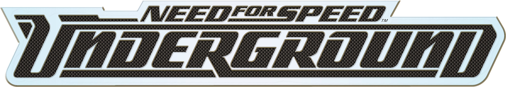
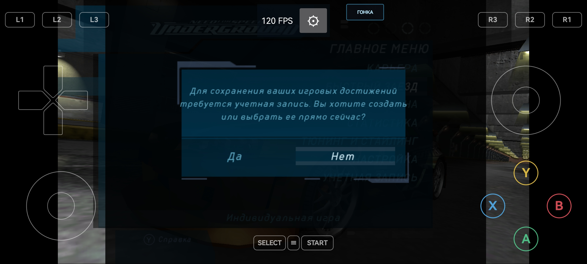
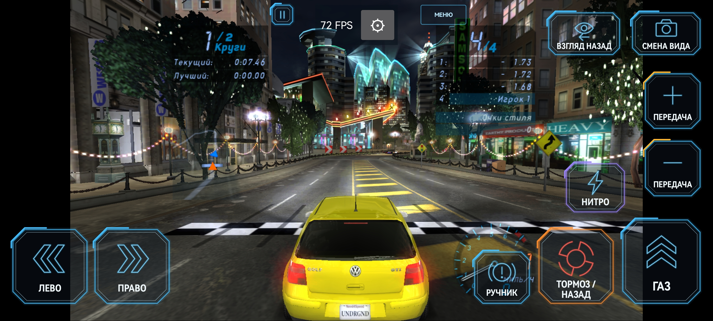
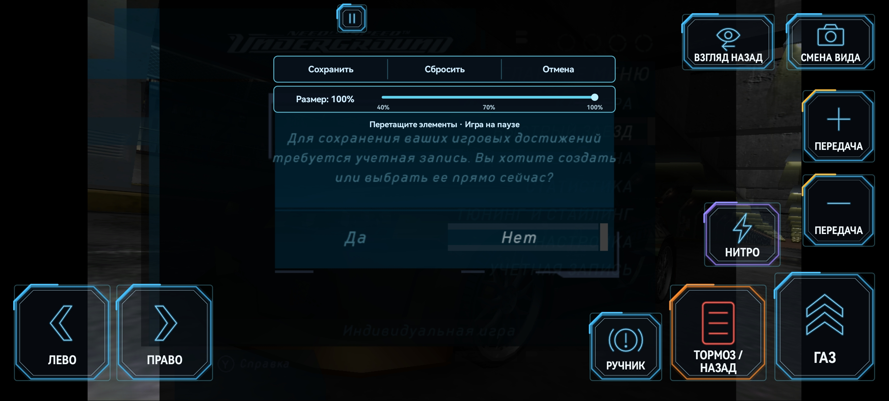
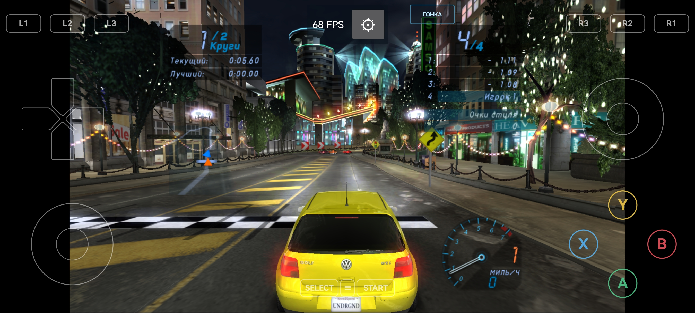
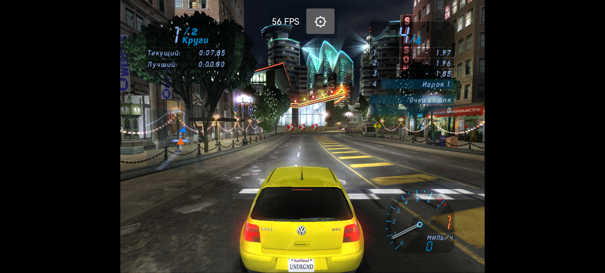
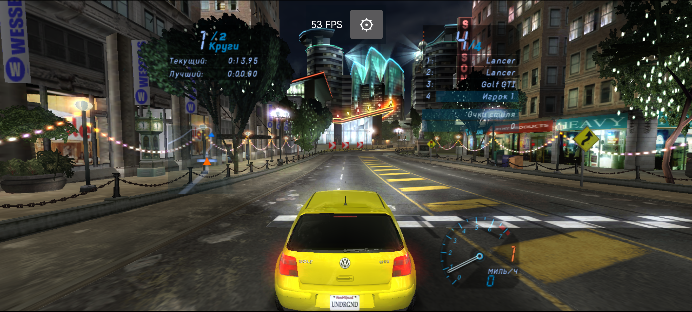

**English** · [Русский](GUIDE-RU.md) · [Project overview](../README.en.md) · [Release notes](RELEASE-NOTES-EN.md)

# Controls, settings and saved progress

Guide for **0.2.0-preview.4**, dated October 22, 2026. This preview adds built-in Purple Turnip T30 for compatible Adreno GPUs and fixes a custom-driver loader crash. The 20:9 mode, RG477M audio fix, controls and backup features are retained. T30 has had limited compatibility testing on Huawei; no FPS improvement is claimed.

The screenshots show the Russian interface. The descriptions below explain the controls in English; select **Settings → Language → English** for the English app interface. Original screenshots are retained as evidence of the tested screens.

## First launch

1. Install the Android ARM64 APK. This build requires Android 10 or newer. Compatibility has been checked on RG477M and Huawei MNA-LX9; other devices require testing.
2. In the launcher, tap **Import ISO / ZIP** and select your own image of the original **Xbox USA version of NFS Underground**, or a ZIP containing the corresponding game files. The PC version and Underground 2 are not supported. The importer checks file contents and checksums; an arbitrary image of another version may be rejected.
3. Keep the app open until import finishes. Choose your settings, then tap **Play**.
4. Create an in-game profile to save your progress. The original game's “account” means a local profile, not a website registration. The Russian **«Создать»** and **«Загрузить»** actions create a profile and open an existing one, respectively.

## Two touch-control layouts

### Menu layout



The screen provides a D-pad, two virtual sticks, A/B/X/Y, L1/L2/L3, R1/R2/R3, Start, Select and **≡**. This layout reproduces Xbox controls; the action depends on the current game screen and your assignments.

- Use the D-pad to select menu items.
- In the tested RG477M configuration, **B** confirms selections inside NFSU. If your physical button labels differ, check the A/B swap setting and individual assignments. Follow the game's prompts for each screen.
- **≡** opens the app menu with pause, settings and return-to-launcher actions.
- By default, **Select** also opens the app menu. **Start** sends the game's normal pause action.
- Android settings screens use different navigation: **A** selects an item and **B** goes back.

The **RACE** label at the top switches to the driving layout. On that layout, the label becomes **MENU**, which restores the full button set. This changes the touch controls; it does not start a race or open NFSU's main menu. The app also selects the layout automatically when the game context changes.

### Race layout



| Control shown in the screenshot | Action |
| --- | --- |
| **ЛЕВО / ПРАВО — LEFT / RIGHT** | Steer the car |
| **ГАЗ — ACCELERATE** | Accelerate |
| **ТОРМОЗ / НАЗАД — BRAKE / REVERSE** | Brake or reverse according to the game's rules |
| **РУЧНИК — HANDBRAKE** | Apply the handbrake |
| **ПЕРЕДАЧА + / − — GEAR + / −** | Shift up or down; particularly relevant with manual transmission |
| **НИТРО — NITRO** | Use the nitrous available in the game |
| **СМЕНА ВИДА — CHANGE VIEW** | Switch camera |
| **ВЗГЛЯД НАЗАД — LOOK BACK** | Look behind while held |
| **Ⅱ** | Open the app menu and pause |

The screen supports simultaneous touches: you can hold the accelerator, steer and press other buttons together. Driving buttons have fixed actions; individual A/B/X/Y assignments apply to the full layout and gamepad.

## Button positions and size



Open **≡ → Touch control positions**. This is also available through the in-game settings. The game pauses while you edit.

1. Drag controls to comfortable positions. The editor moves controls in the current layout; configure the other layout separately.
2. In the race layout, the **Size** slider adjusts button size from **40% to 100%**. It does not change the game's resolution or the car's speed.
3. Tap **Save** to store positions and size. They persist after restarting the app.

**Reset** restores the default positions; in the race layout it also restores 100% size. Tap Save to keep the reset. **Cancel** restores the state from before you opened the editor. On a gamepad, Start saves changes; Select or Android Back cancels them. After closing the editor, you can choose **Resume game**.

## Gamepads and button assignments



Settings has separate **Touch buttons** and **Gamepad** tabs. Each position can be assigned an Xbox action: D-pad, Start, Back, stick clicks, A/B/X/Y, Black, White, LT, RT, the app menu or Unassigned.

- Default shoulder mapping: **L1 → Black, R1 → White, L2 → LT, R2 → RT**.
- **Swap A/B and X/Y** supports physical gamepads with a different letter order. Individual assignments override the general swap.
- Assignments save immediately. Changes made in the launcher apply on the next launch; changes made in the in-game settings apply when you return to the game.
- **Reset layout** resets the assignments of the selected tab. It does not erase your career or reset touch-button coordinates.

## Performance defaults on a new installation

For a new installation, the public build enables a separate render thread, dynamic geometry arenas and car-reflection updates once every three frames. The last setting reduces the update rate of reflections on the bodywork; the main scene still renders every frame. Updating the app does not overwrite existing settings.

Some older test APKs enabled these options only through a saved internal configuration file. Installing one of those older APKs on another device did not guarantee the same performance settings. The current interface has no single switch for this entire set of options.

## Graphics and app settings

Launcher settings save automatically. During gameplay, tap the gear beside the FPS counter to pause and open settings. Some options are available there; the graphics driver and FPS limit are selected in the launcher and require a new game launch.

| Setting | Options and effect |
| --- | --- |
| **Aspect ratio** | 4:3, 16:9 or **20:9**. Wide formats expand the horizontal field of view. HUD and menu proportions are preserved. Displays with a different aspect ratio may show black bars; touch controls can be placed over them. |
| **Internal resolution** | 1×, 2×, 3×: 640×480, 1280×960 and 1920×1440. Some old test APKs incorrectly displayed 720×480; the public release fixes those labels. Higher resolution increases GPU load and memory use. |
| **FPS limit** | 60 or 120. This is an upper limit, not a guaranteed frame rate. Visible smoothness also depends on the display, workload and temperature. Applies after a new game launch. |
| **Graphics driver** | System Vulkan, MaliSX2 for compatible Mali GPUs, Purple Turnip T30 · Adreno, or a custom driver imported from ZIP. System Vulkan is the default. |
| **Install ZIP…** | Import a compatible custom driver. The package must match your GPU and Android version; being a ZIP does not guarantee compatibility. The change is confined to this app and does not replace Android's system driver. |
| **Remove driver** | Remove the imported package and return to the system driver. Restart the game to apply. |
| **Touch controls** | Auto hides controls when a gamepad is detected; Show keeps them visible; Hide removes them. |
| **Language** | Russian or English. Changes the app interface; the language of game resources applies on a new game launch. |

### Purple Turnip T30 for Adreno

1. Close the running game and open the launcher settings.
2. Under **Graphics driver**, select **Purple Turnip T30 · Adreno**.
3. Launch the game again. You do not need to download or import the built-in package separately.

The driver operates only inside NFSU and does not change Android. System Vulkan, built-in MaliSX2 and the custom ZIP slot remain available. If a selected driver prevents the game from starting, return to the launcher, choose **System Vulkan** and launch again. Switching does not require clearing data or reinstalling the game.

T30 requires Android 11+, ARM64, 4 KB or 16 KB memory pages and a suitable Adreno GPU. The option is unavailable on Mali, unknown GPUs, Adreno models outside the 6xx/7xx/8xx families, and **Adreno 710/720**, for which the T30 author reports limitations. A matching model number does not guarantee compatibility with every device and firmware. Hardware testing was performed on Huawei HWMNA; a complete list of tested Adreno models is not yet available.

Source: [Purple Turnip T30, MrPurple666](https://github.com/MrPurple666/purple-turnip/releases/tag/vturnip_mrpurple_T30-toasted.adpkg). The original archive is embedded unchanged. This is a separate selection; your previously imported custom package is not overwritten.

### 20:9 mode

In the launcher, choose **Settings → Aspect ratio → 20:9**. During gameplay, open the gear beside FPS or **≡ → Settings**, select **Aspect ratio → 20:9**, then **Resume game**. You can switch between 4:3, 16:9 and 20:9 without relaunching the game. Your choice persists after restarting the app.

20:9 shows more of the environment on both sides while preserving the vertical field of view. The car, round speedometer, text and menu elements retain their proportions. The HUD and menus stay within a central 4:3 area rather than spreading to the outer edges. Touch controls can be positioned separately in the editor.

**4:3 on Huawei:**



**The same car position and camera in 20:9:**



These images were taken sequentially in the running game; time, opponents and lighting may have changed. They illustrate field of view and proportions, not FPS performance. If your screen is not 20:9, the app fits the image with bars. Choosing 20:9 does not change the 1×/2×/3× internal scale or FPS limit; no separate performance guarantee is made for the wide mode.

Updating retains the previously selected format. Select 20:9 manually to use it. Install updates over the existing app: uninstalling may erase internal progress. Keep an external profile backup before updating. Android or Huawei's installer may block an APK with a lower version number; uninstalling solely to downgrade is not recommended.

Resolution, aspect ratio, button visibility and assignments changed in the in-game settings apply after **Resume game**. If the app cannot allocate memory for a new resolution, it keeps the old one and displays a message. The app menu language may change immediately, but changing the game's language requires a restart.

The app menu also includes **Return car to track** during a race and **Exit to launcher**. Returning the car does not finish the race or save its result. NFSU's own options, including sound and transmission, are in the game's menu.

## Audio fix for RG477M

Starting with **0.2.0-preview.3**, RG477M automatically uses **OpenSL ES**, **48 kHz stereo** and a **512-frame buffer**. This includes RG477M devices running GammaOS. After updating, fully close and relaunch the game; the new output is selected automatically.

Audible Bluetooth interference was reproduced with the previous AAudio path. In short title/menu tests using OpenSL ES, the user confirmed clean sound through **Bluetooth headphones, wired headphones and built-in speakers**. A separate check of the unified test build confirmed automatic output selection without diagnostic settings. The music, game audio data and mixer were unchanged.

The fix applies to RG477M. The existing Huawei HWMNA output policy is retained; other devices keep their previous path. NFSU's volume and sound options remain available in its own menu.

Tests used an output connected before launch. Long races, audio latency and switching output during gameplay were not separately tested. This fix is not claimed to improve FPS or implement missing original Xbox audio effects.

Install the update over the existing app, keeping its data. Russian language support, controls, the selected 4:3/16:9/20:9 format and backup features are retained.

## How progress is saved

There are three separate kinds of saved data:

1. **The in-game profile** stores the career and state written by NFSU itself. Use the game's normal save or autosave and wait for it to finish. Exiting to the launcher does not turn an unfinished race into a saved checkpoint.
2. **App settings** store language, graphics options, assignments and touch-control positions. They are separate from career progress.
3. **Automatic profile backups** are exported to shared device storage. They let you transfer progress that has already been saved in the game to another device.

The working profile copy is in the app's private storage:

```text
/data/user/0/org.nfsu.port/files/saves/UserData/45410047/
```

This contains profile folders. Each profile includes a `*.nfs` file and supporting files such as `SaveMeta.xbx` and `saveimage.xbx`. Ordinary Android file managers may not have access to this private area; use the shared backup for transfers.

**Download/NFSU** is not the game's working folder. Manually edited files there are not loaded automatically. Use the launcher's restore command.

## Automatic backups in Download

After saves change, the app creates a new completed backup in:

```text
/storage/emulated/0/Download/NFSU/Saves/
```

In a file manager, this is usually **Internal storage → Download → NFSU → Saves**. Each snapshot is a separate folder with this structure:

```text
NFSU-<date>-<time>-<identifier>/
    NFSU-backup.txt
    UserData/
        45410047/
            <profile-folder>/
                <profile-name>.nfs
                SaveMeta.xbx
                saveimage.xbx
            ...
```

- Backups run in the background after written files stabilize. After saving in the game, allow a few seconds; do not immediately force-stop the app.
- The app retains the **latest 10 generations created by this installation**. Folders manually copied from elsewhere are not part of that installation's cleanup history.
- `NFSU-backup.txt` lists files, sizes and checksums. It appears when export completes and is required for restoration. Transfer the whole folder, not just `*.nfs`.
- Backups contain game profiles. They **do not contain** imported game files, graphics drivers, graphics settings, button assignments or button positions.
- A failed export does not erase internal progress. Until a new complete backup is successfully created, however, the shared folder may contain only older progress.

This is a local backup, not cloud synchronization. To protect against loss of the device, also copy it to a computer or other storage.

## Moving progress to another device

1. Save in the game on the old device and wait for writing to finish. Check for a recent folder containing `NFSU-backup.txt` in `Download/NFSU/Saves`.
2. Copy **the entire folder of one completed generation**, or the whole **Saves** folder, to the new device. Preserve `UserData/45410047` and every supporting file.
3. Install a compatible app version on the new device and import your own game files.
4. Keep the game closed. In the launcher, open **Settings → Saved progress → Restore saved progress…**.
5. In the system folder picker, select one generation's folder, `Saves`, or its parent `NFSU`. If you choose a folder containing several generations, the app selects the latest completed generation by name. To restore a specific date, choose that generation directly.
6. Wait for the progress-restored confirmation. Launch the game, select the load-profile action and open your profile.

Before replacement, the app preserves the previous internal copy separately. Restoration checks completeness and checksums; incomplete or modified sets are rejected. Import replaces this game partition's save set rather than merging careers. Keep an exported copy of the receiving device's progress before transferring.

Simply copying an `.nfs` file into Download is not enough. If your file manager does not show a backup, check that the game actually saved a profile and that the folder contains a completed set with its manifest.

## Updating and uninstalling

Installing a compatible update with the same package and signing certificate retains internal game files, progress and settings. Do not uninstall for a routine update. If Android reports a signature conflict, first secure an external backup and check where the APK came from.

**Uninstalling the app or clearing its data deletes internal saves and settings.** Before either action, copy the shared backup to a safe location and check that it is complete. A file manager or storage cleaner may also delete files in Download.

Saving a button layout, saving settings and saving your career are independent actions. The **Save** button in the editor screenshot saves only touch-control configuration.
